# Лабораторная работа №6. Система контроля версий

**Студент:** 4515 Лукин Е.А.

**Цель работы:** изучение базовых возможностей системы управления версиями, опыт работы с Git API, опыт работы с локальным и удалённым репозиторием.

**Репозиторий:** https://github.com/gnutel3/LR6

---

## Ход работы

### 1. Настройка клиента Git

Проверена версия Git, заданы имя пользователя и email, просмотрена конфигурация.

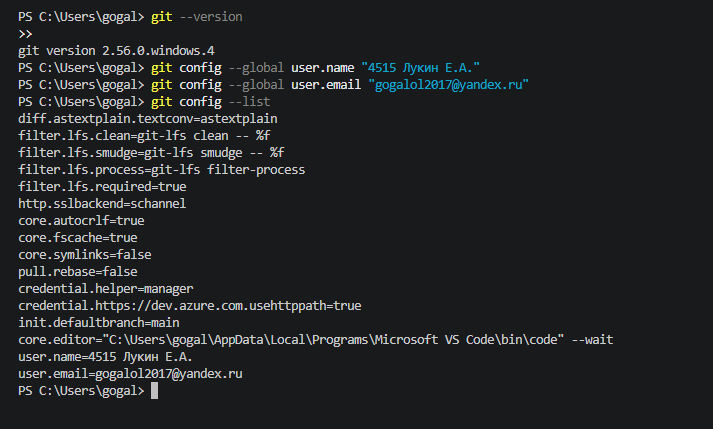

### 2. Клонирование личного репозитория

Выполнен fork репозитория https://github.com/Kurtyanik/LR6/ и клонирование своей копии на компьютер.

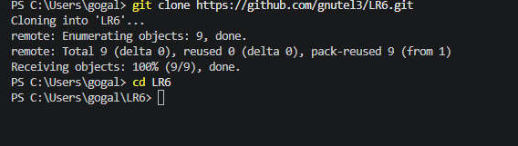

### 3. Добавление файла через интерфейс GitHub

На сайте GitHub через **Add file → Create new file** создан файл `test.txt`.

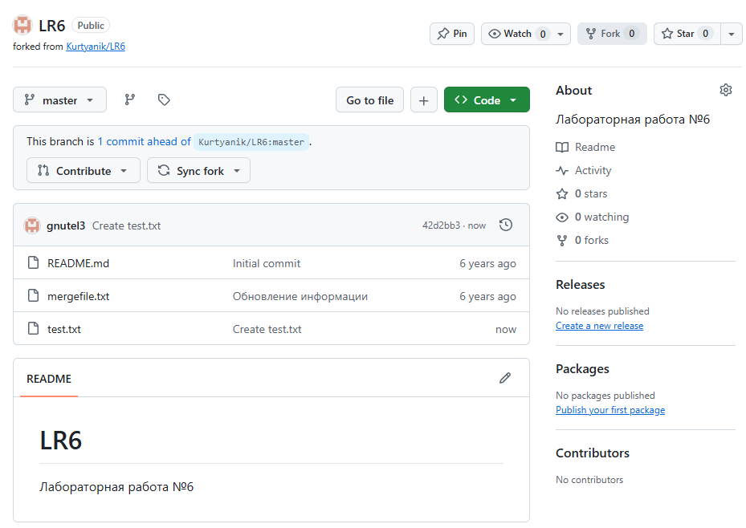

### 4. Получение изменений в локальный репозиторий

Изменения подтянуты командой `git pull`.

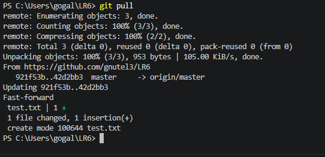

### 5. Список веток

Создана побочная ветка `feature`, просмотрен список веток.

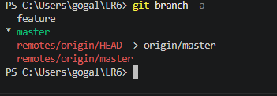

### 6. История ветки master

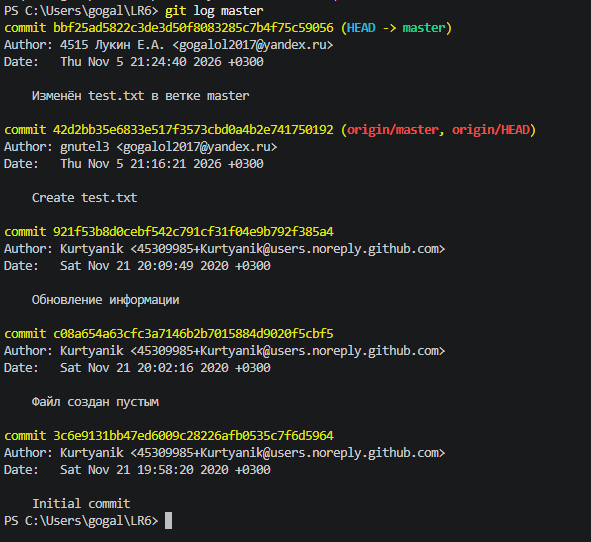

### 7. История ветки feature

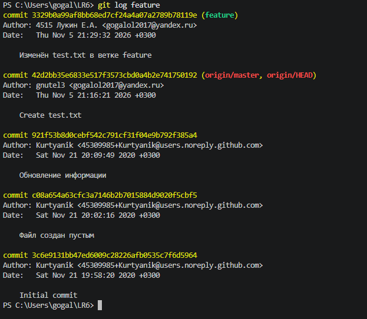

### 8. История всех веток в виде графа

Видно, что ветки `master` и `feature` разошлись от общего коммита.

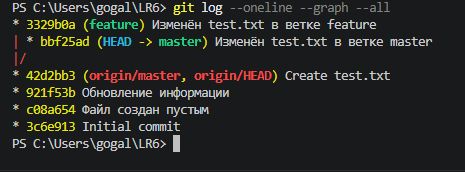

### 9. Просмотр последних изменений (`git show`)

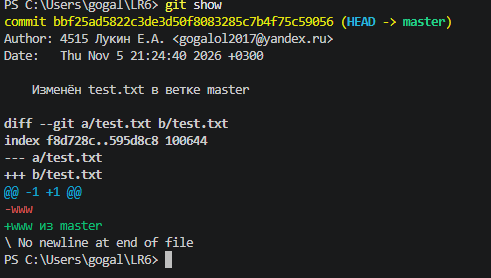

### 10. Сравнение веток (`git diff`)

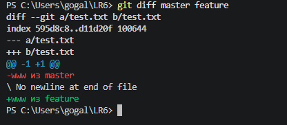

### 11. Слияние веток и возникновение конфликта

Выполнено слияние `feature` в `master`. Обе ветки изменяли один и тот же файл `test.txt`, поэтому возник конфликт.

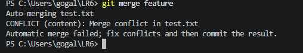

### 12. Файл с маркерами конфликта

В файле `test.txt` присутствуют маркеры `<<<<<<<`, `=======`, `>>>>>>>`.

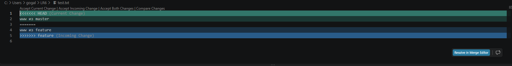

### 13. Разрешение конфликта

Маркеры удалены, оставлены строки из обеих веток. Конфликт разрешён вручную, изменения зафиксированы коммитом.

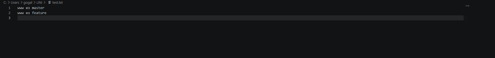

### 14. История после слияния

Линии веток `master` и `feature` сошлись в коммите слияния.

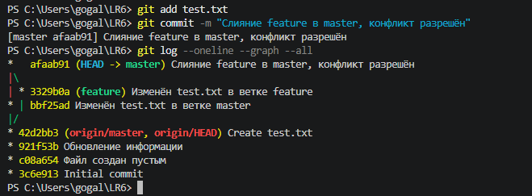

### 15. Удаление побочной ветки

После успешного слияния ветка `feature` удалена.

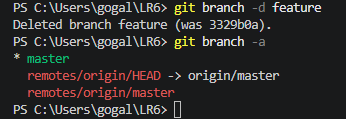

### 16. Несколько коммитов и откат коммита

Сделано три коммита с комментариями (добавлены строки в `test.txt`, создан файл `notes.txt`). Последний коммит отменён командой `git revert HEAD`.

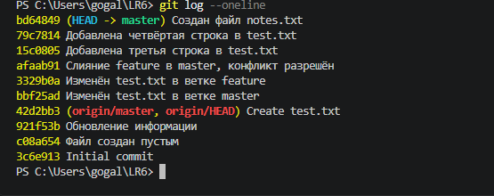

### 17. Создание ветки для отчёта

Создана ветка `report` и папка `screenshots` для снимков экрана.

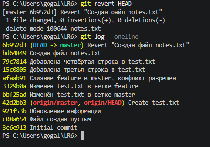

### 18. Форматированная история операций

История получена в формате: сокращённый хэш, дата, имя автора, комментарий.

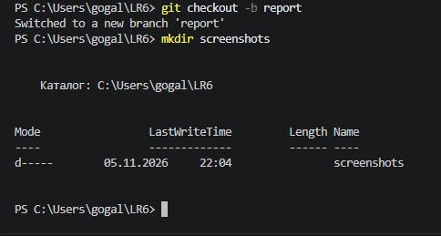

---

## Лог команд

```
git --version
git config --global user.name "4515 Лукин Е.А."
git config --global user.email "gogalol2017@yandex.ru"
git config --list
git clone https://github.com/gnutel3/LR6.git
cd LR6
git pull
git checkout -b feature
git add test.txt
git commit -m "Изменён test.txt в ветке feature"
git checkout master
git add test.txt
git commit -m "Изменён test.txt в ветке master"
git branch -a
git log master
git log feature
git log --oneline --graph --all
git show
git diff master feature
git merge feature
git add test.txt
git commit -m "Слияние feature в master, конфликт разрешён"
git log --oneline --graph --all
git branch -d feature
git branch -a
git add test.txt
git commit -m "Добавлена третья строка в test.txt"
git add test.txt
git commit -m "Добавлена четвёртая строка в test.txt"
git add notes.txt
git commit -m "Создан файл notes.txt"
git log --oneline
git revert HEAD
git log --oneline
git checkout -b report
mkdir screenshots
git add .
git commit -m "Добавлена папка со скриншотами"
git add .
git commit -m "Добавлены разделы отчёта и лог команд"
git log --pretty=format:"%h %ad %an %s" --date=short
git add .
git commit -m "Финальная версия отчёта"
git push origin master
git push origin report
```

---

## История операций

Команда: `git log --pretty=format:"%h %ad %an %s" --date=short`

```
8966928 2026-11-05 4515 Лукин Е.А. Добавлена папка со скриншотами
6b952d3 2026-11-05 4515 Лукин Е.А. Revert "Создан файл notes.txt"
bd64849 2026-11-05 4515 Лукин Е.А. Создан файл notes.txt
79c7814 2026-11-05 4515 Лукин Е.А. Добавлена четвёртая строка в test.txt
15c0805 2026-11-05 4515 Лукин Е.А. Добавлена третья строка в test.txt
afaab91 2026-11-05 4515 Лукин Е.А. Слияние feature в master, конфликт разрешён
3329b0a 2026-11-05 4515 Лукин Е.А. Изменён test.txt в ветке feature
bbf25ad 2026-11-05 4515 Лукин Е.А. Изменён test.txt в ветке master
42d2bb3 2026-11-05 gnutel3 Create test.txt
921f53b 2020-11-21 Kurtyanik Обновление информации
c08a654 2020-11-21 Kurtyanik Файл создан пустым
3c6e913 2020-11-21 Kurtyanik Initial commit
```

---

## Вывод

В ходе работы изучены базовые возможности системы контроля версий Git: настройка клиента, клонирование репозитория, работа с ветками, слияние с разрешением конфликта, фиксация изменений, откат коммита, оформление отчёта в формате Markdown и отправка изменений на GitHub.